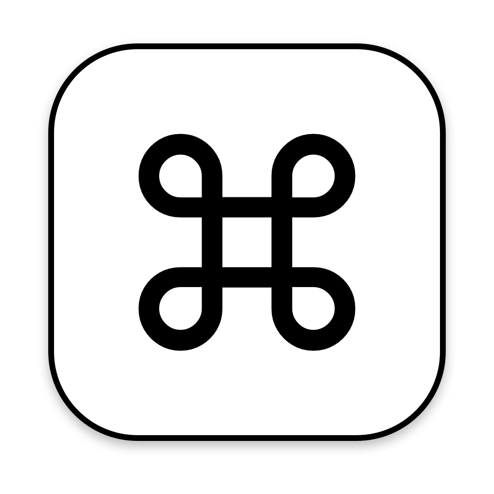
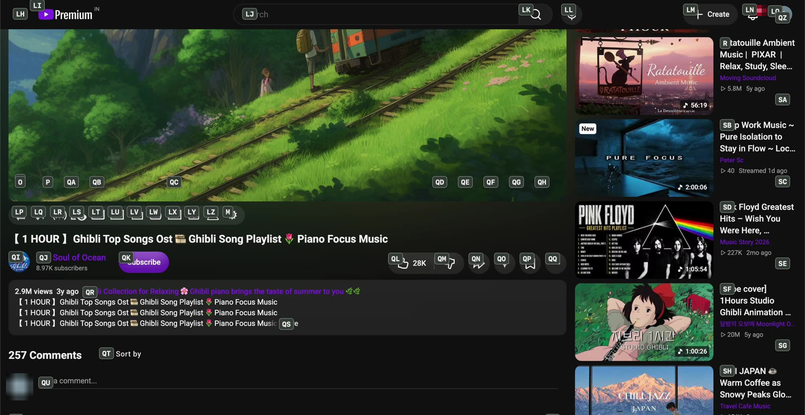
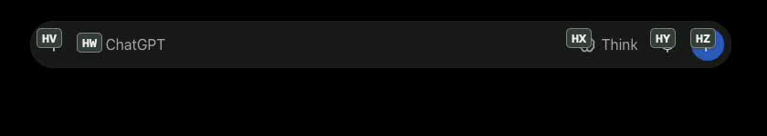
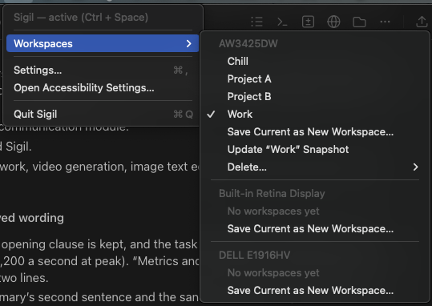
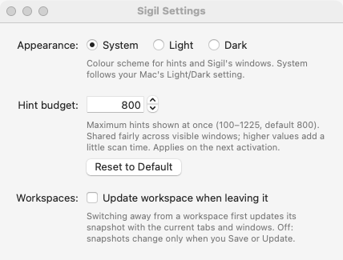

# Sigil

Drive your whole Mac from the keyboard.

## Why

Using the mouse to get around is slow. Every click means taking a hand off the keyboard,  
finding the cursor, steering it across the screen (or across three screens), landing on a small  
target, and coming back. You can see it infront of your eye but you can't reach it without dragging the cursor all the way to it.

Browsers solved this years ago. [Vimium](https://github.com/philc/vimium), the Vim-style
extension for Chrome, puts a short letter label on every link; you type the label and the link
is clicked. Your hands never leave the keyboard. But Vimium stops at the edge of the web page: it
can't reach the browser's own toolbar, let alone Finder, Slack, or a window on another display.

Sigil brings that idea to all of macOS. One hotkey labels everything clickable in every visible
window on every display, in any app. It also covers the other reasons you reach for the mouse:
jumping between windows, and rearranging them when you change what you're working on.

## Features

### Keyboard hints

Press **Control + Space**. Every element you could click (buttons, links, tabs, text fields,
menu-bar items) gets a two-letter label. Type the two letters and Sigil activates that element
for you.



- Works in native apps, browsers and Electron apps alike. Sigil reads the same Accessibility
information that VoiceOver uses, so apps need no plugin or integration
- Covers every visible window on every display in a single pass, not only the frontmost app
- Labels are always two characters, so every target costs the same two keystrokes



| Key | Action |
|-----|--------|
| **Control + Space** | Show or hide hints |
| two letters | Activate the labelled element |
| **Delete** | Undo the last typed character |
| **Esc** | Cancel |

### Window switcher

Press **Control + Shift + Space** and start typing a window title or an app name. The list
narrows as you type.

| Key | Action |
|-----|--------|
| **Control + Shift + Space** | Open the switcher |
| typing | Filter by window title or app name |
| **1–9** or **Return** | Focus the chosen result |
| **Esc** | Cancel |

> Window titles are read through the Accessibility API, which only exposes windows on the
> current Space. Windows on other Spaces are still reachable by their app name.

### Workspace manager

A workspace is a saved window layout for **one display**: which apps have windows there, where
each window sits, and how they stack. Save one for each kind of work, such as coding, writing or
a call, and switch between them instead of dragging windows around. Each display keeps its own
list, so changing the workspace on one screen leaves the others alone.

Open the Sigil menu → **Workspaces**:



- **Save Current as New Workspace…** snapshots what is on that display now
- Click a workspace to switch to it. Apps that aren't running are launched, windows are moved
back into place and re-stacked, and windows on that display that aren't part of the workspace
are minimized, never closed
- **Update “…” Snapshot** overwrites the active workspace with the current layout
- **Delete…** removes a workspace

Switch in Progress


Two apps are restored more deeply than position alone:

- **Google Chrome**: the tabs of each window and which one is active. Missing tabs are
reopened; existing tabs are never closed
- **Claude desktop**: the chat each window was showing

### Settings

Open the Sigil menu → **Settings…**



**Custom hint limit.** The *hint budget* is the most hints Sigil shows at once: 800 by default,
adjustable from 100 to 1225. The budget is shared fairly across visible windows, so a busy
front window never starves the ones behind it. Lower it for a calmer screen and a slightly
faster scan; raise it if you keep many dense windows open. 1225 is the ceiling because that is
how many two-character labels exist, which keeps every hint at two keystrokes.

**Update workspace when leaving it.** Off by default, so a workspace changes only when you
save or update it yourself. Turn it on and Sigil re-snapshots the workspace you are leaving on
every switch, so tabs you opened and windows you moved are there when you come back.

**Appearance.** Hints and Sigil's own windows can follow the system's Light/Dark setting or be
pinned to either one.

## How it works

Sigil is a small menu-bar app written in Swift, with no dependencies beyond the macOS SDK. It
has no window of its own most of the time; it listens for its hotkeys and draws over other apps
only while you are using it.

**Hints** are a four-step pipeline, run each time you press the hotkey:

1. **Scan.** Sigil walks the Accessibility tree of every visible window and collects the

   elements that can be pressed or focused, skipping anything hidden behind another window.
2. **Label.** The elements are trimmed to the hint budget, shared across windows, and each gets

   a unique two-character label.
3. **Draw.** A transparent, click-through window on each display paints the labels over their

   targets. Nothing underneath is disturbed.
4. **Act.** When you finish typing a label, Sigil presses the element through the Accessibility

   API. For web content that ignores that, it falls back to a synthetic mouse click at the
     element's position.

A single global keyboard tap sits in front of all this. It passes every keystroke through
untouched until a hotkey fires, then routes keys to the active mode until that mode ends.

**Workspaces** are snapshots. Saving one records, for a single display, each window's app,
position and stacking order, plus Chrome's tabs (read over AppleScript) and Claude's current chat
(read from its Accessibility tree). Switching replays the snapshot: launch what's missing, move
and re-stack windows, minimize the rest. Snapshots are plain JSON in
`~/Library/Application Support/Sigil/workspaces.json`.

| Concern | Component |
|---------|-----------|
| Global hotkeys and keystroke routing | `InputTap` (`CGEventTap`) / `InputCoordinator` |
| Finding actionable elements in every visible window | `AccessibilityScanner` |
| Sharing the hint budget across windows | `HintBudget` |
| Short, unique labels | `HintGenerator` |
| Accessibility ↔ screen coordinates across displays | `Geometry` |
| Click-through overlay | `OverlayController` / `OverlayView` |
| Activating the target (press → focus → synthetic click) | `ActionExecutor` |
| Hint mode end to end | `HintModeController` |
| Window switcher | `WindowSwitcher` / `WindowSwitcherController` / `SwitcherOverlay` |
| Workspaces | `WorkspaceMenuController` / `WorkspaceSwitcher` / `WorkspaceStore` |
| Settings | `SigilSettings` / `SettingsWindowController` |

## Requirements

- macOS 13 or later
- Xcode with the Swift 6 toolchain, to build
- **Accessibility permission** (System Settings → Privacy & Security → Accessibility). Sigil
asks on first launch; the menu-bar icon shows a ⚠︎ until access is granted, then Sigil starts
on its own
- **Automation permission for Google Chrome**, only if you use workspaces with Chrome. macOS
asks the first time Sigil reads or restores Chrome's tabs

## Build and run

```bash
# Build and assemble a code-signed .app bundle
./scripts/bundle.sh

# Launch it
open .build/Sigil.app
```

A real `.app` bundle is required: macOS ties the Accessibility grant to the app's bundle
identity and code signature, so running the bare SwiftPM binary gives flaky permission
behaviour.

`bundle.sh` signs with a *Developer ID Application* certificate if your keychain has one. If
not, it falls back to a self-signed identity (create it once with
`./scripts/create-signing-cert.sh`) so the permission grant survives rebuilds, and finally to
ad-hoc signing, which loses the grant on every build. Set `SIGN_IDENTITY` to choose an identity
yourself.

For a quick compile check or to run the tests during development:

```bash
swift build
```

```bash
swift test
```

To package a distributable `.dmg`, see `scripts/dmg.sh`.

## License

[MIT](LICENSE)
